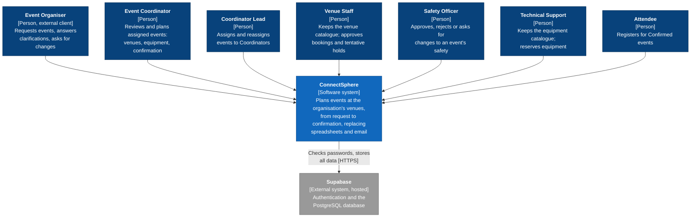
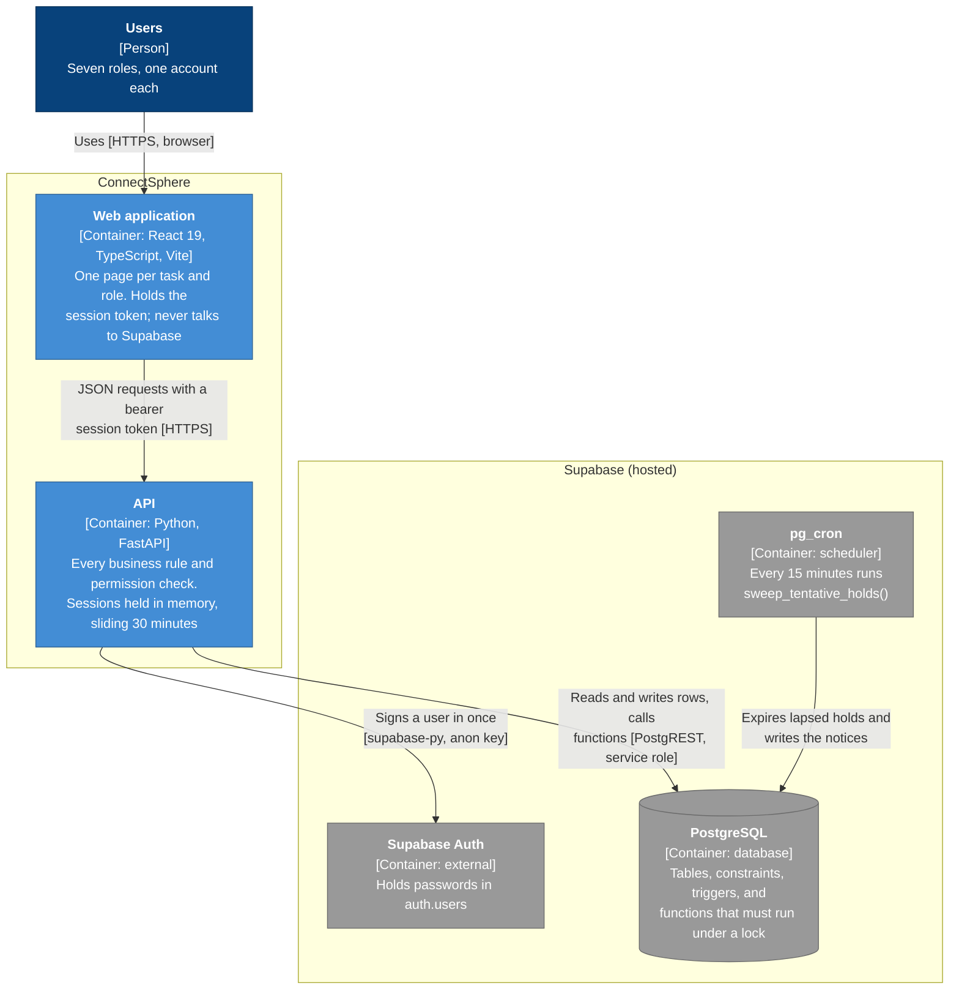
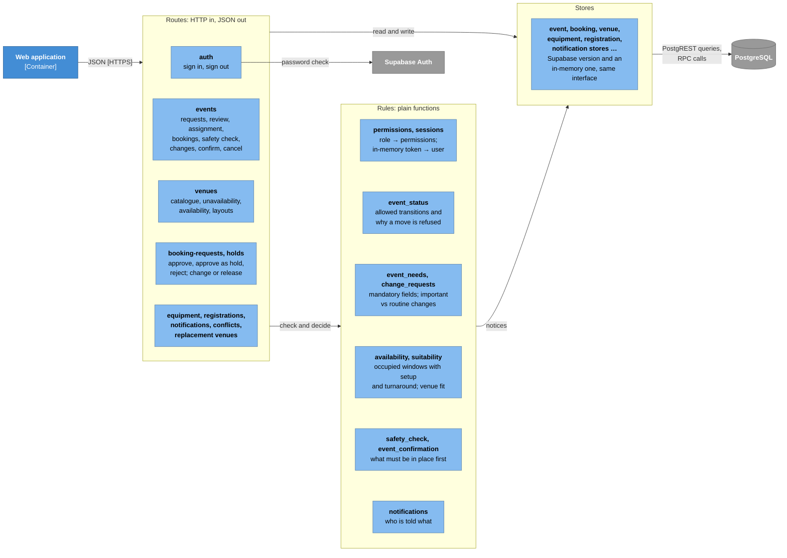

# ConnectSphere: system design (C4)

The C4 model at three levels, drawn from the code on `main` (November 2026).
Level 1 shows who uses ConnectSphere and what it depends on; Level 2 the
deployable parts and how they talk; Level 3 the parts of the API. A last
section says where each kind of rule lives, because some live in Python and some
in the database on purpose.

## Level 1: System context

Accounts are pre-loaded; nobody signs up (Week 4, Week 9). Every notice is
in-app; there is no email or push service.

## Level 2: Containers

* **Only the API holds Supabase keys.** The browser talks to the API and never
  to Supabase, so the service-role key never leaves the server (README).
* **Sessions are the API's own.** Supabase Auth checks the password once, at
  sign-in; after that the API issues an opaque token and keeps it in memory, so
  signing out ends it at once (US1.2) and an idle session lapses after 30
  minutes (US1.1). Restarting the API signs everyone out.
* **How it runs today:** both containers run locally (`uvicorn`, `vite`) against
  a hosted Supabase project; there is no production deployment. GitHub Actions
  builds and tests every pull request, including a PostgreSQL 16 built from the
  repo's SQL and 50 browser journeys.

## Level 3: Components of the API

* **Routes** check who may act (`require_permission`, then "is this your event"
  as a 404, so other people's events stay invisible), validate the input, and
  answer in the user's terms (400 with a sentence; 409 with the reason a move
  was refused).
* **Rules** are plain functions with no storage, so each is unit-tested on its
  own (e.g. `event_status.transition_allowed`, `availability.check_slot`).
* **Stores** are the only code that knows about Supabase. The in-memory version
  of each mirrors what the database does, including what its functions and
  triggers do; the unit tests and the browser journeys run against those, so
  they can never change the team's real data.

## Where the rules live

| Kind of rule | Lives in | Why there | Examples |
| --- | --- | --- | --- |
| Who may do what | API (`permissions.py`, routes) | One place, readable, unit-tested | Only the assigned Coordinator plans an event; only Venue Staff decide bookings |
| Validation and the words a user sees | API (routes, `event_needs.py`) | Messages belong with the form they explain | "The hold must expire no later than the booking starts." |
| Workflow transitions | API (`event_status.py`) **and** a database trigger | The API explains a refusal; the trigger makes a wrong status impossible even from outside the API | Confirmed only through the Coordinator's confirm; Safety approval never confirms on its own |
| Anything two people could race on | Database functions, under row locks | Two requests checked at once in Python could both pass | One approval per slot (`approve_venue_booking`, `approve_venue_booking_as_hold`); last registration place (`register_for_event`); equipment stock |
| Things that happen with nobody acting | Database (trigger, pg_cron) | Must happen even if the API is down | A closed venue flags its bookings and sends a Confirmed event back to Planning; lapsed holds expire every 15 minutes |
| Integrity | Database constraints | The last line of defence | A Held booking always has an expiry; a decision records who and when |

The database half is tested against a real PostgreSQL in CI
(`backend/integration/`), including a fresh database built from every SQL
script in order (`backend/scripts/fresh_install.py`).
